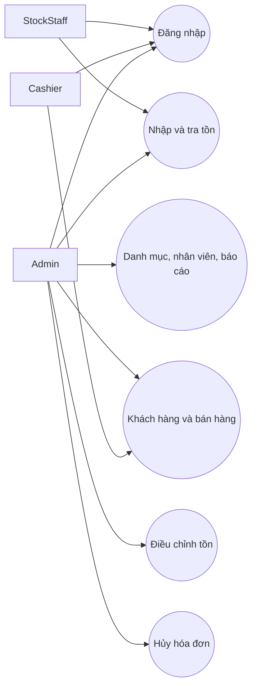
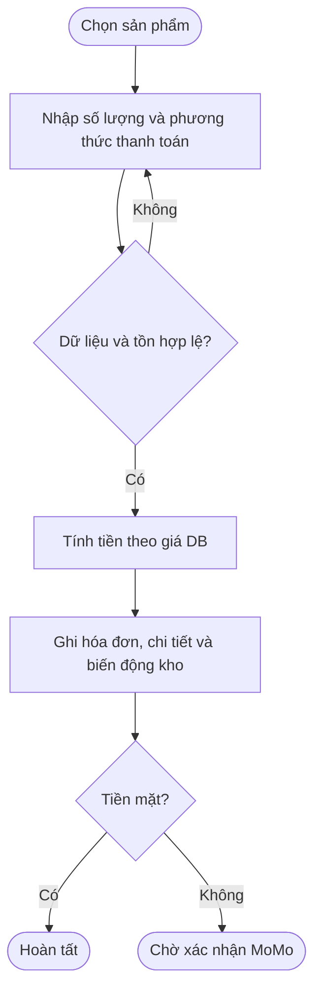
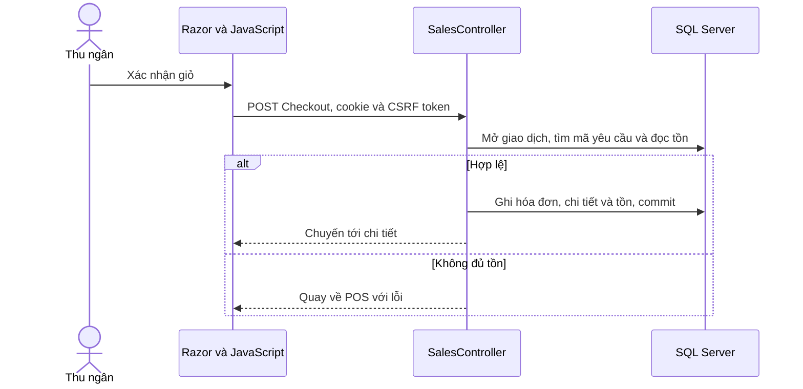
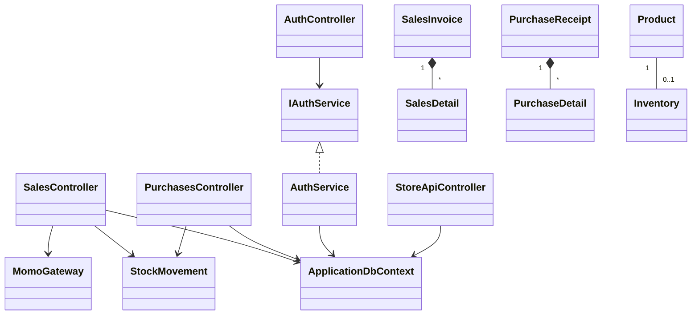
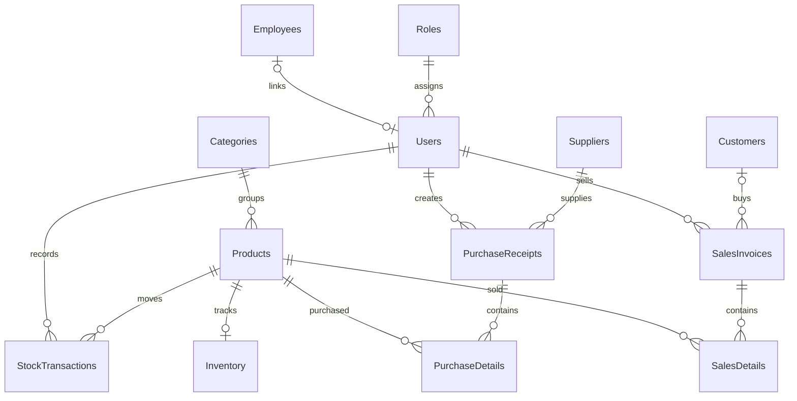

# Thiết kế

## Use Case

## Activity bán hàng

## Sequence bán hàng

## Class Diagram

## ERD

Khóa, kiểu cột, chỉ mục và CHECK được định nghĩa trong CoSoDuLieu/01_CreateDatabase.sql. Khóa chính của Inventory đồng thời là khóa ngoại ProductId. StockTransactions lưu tham chiếu nghiệp vụ theo cặp loại và ID chứng từ.
